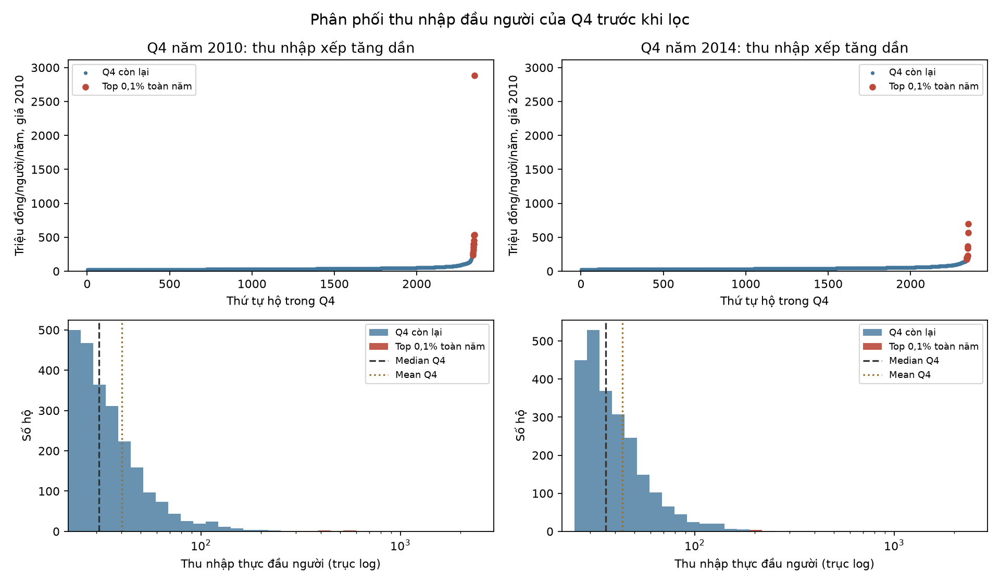

# Thu nhập đầu người 2010–2014

[**Mở notebook**](thu_nhap_2010_2014.ipynb) — có kết quả đã chạy cho **toàn mẫu** và **bỏ top 0,1% mỗi năm**. Cập nhật 11/11/2026.

## Câu hỏi

1. Thu nhập thực bình quân đầu người có tăng không?
2. Thu nhập thực bình quân từng Q1–Q4 có tăng không? CI 95% của mức tăng là bao nhiêu?
3. Thu nhập thực bình quân thành thị và nông thôn có tăng không? CI 95% của mức tăng là bao nhiêu?

## Dữ liệu và cách làm

`income` là tổng thu nhập hộ cả năm, đơn vị nghìn đồng; `size` là mọi thành viên. Thu nhập đầu người theo giá 2010, đơn vị triệu đồng/người/năm:

$$Y=\frac{income}{size}\times\frac{100}{CPI}\times\frac1{1000}.$$

CPI bình quân: 2010 = 100; 2014 = 143,69. [Nguồn và cách quy đổi](CPI_nguon_va_cach_quy_doi.md).

Hai năm là hai mẫu hộ độc lập; mỗi hộ có trọng số bằng nhau. Mean là trung bình thu nhập đầu người của các hộ. Giữ nhãn Q gốc; `area`: 1 = thành thị, 2 = nông thôn. Bản lọc bỏ đúng 10 hộ cao nhất trong toàn năm, trước khi chia theo Q/khu vực; không chia lại Q.

**Các bước:** đọc Excel → quy giá 2010 → xem phân phối Q4 → tạo hai bản mẫu → kiểm tra phân phối → kiểm định và CI 95% → đối chiếu.

Với từng phạm vi, đặt $\Delta=\mu_{2014}-\mu_{2010}$; **H₀: Δ=0; H₁: Δ>0**. Dùng **t-test hai mẫu độc lập, phương sai chưa biết và không giả sử bằng nhau, phía phải — Chap 7 §7.2.4, trang 14**. CI 95% hai phía của chênh lệch mean dùng cùng SE và bậc tự do trong slide. Kiểm tra Jarque–Bera theo **Chap 9 §9.4, trang 21**.

## Phân phối Q4 trước khi lọc

Top 0,1% đóng góp **89,3% SS của Q4 năm 2010** và **53,6% năm 2014**. Đây là cơ sở đối chiếu thêm bản lọc, không phải bằng chứng các hộ giàu ghi sai. Biểu đồ giữ mọi quan sát; trục log chỉ dùng ở histogram.

## Kết quả

Đơn vị mức tăng và CI: **triệu đồng/người/năm, giá 2010**. CI là của chênh lệch mean 2014−2010, không phải khoảng chứa 95% số hộ.

| Phạm vi | Tăng — toàn mẫu | CI 95% — toàn mẫu | Tăng — bỏ top 0,1% | CI 95% — bỏ top 0,1% |
|---|---:|---:|---:|---:|
| Toàn mẫu | 2,604 | [1,771; 3,436] | 2,944 | [2,468; 3,421] |
| Q1 | 1,035 | [0,931; 1,139] | 1,035 | [0,931; 1,139] |
| Q2 | 2,642 | [2,542; 2,742] | 2,642 | [2,542; 2,742] |
| Q3 | 3,665 | [3,514; 3,816] | 3,665 | [3,514; 3,816] |
| Q4 | 3,097 | [0,166; 6,029] | 4,467 | [3,281; 5,652] |
| Thành thị | 2,444 | [1,110; 3,778] | 2,559 | [1,458; 3,661] |
| Nông thôn | 2,425 | [1,418; 3,432] | 2,861 | [2,412; 3,310] |

Theo từng kiểm định xấp xỉ ở mức 5%, cả hai bản đều bác bỏ H₀ ở toàn mẫu, từng Q và từng khu vực: có bằng chứng thu nhập thực bình quân tăng. Toàn mẫu tăng **14,26%**; bản bỏ top 0,1% tăng **16,73%**. Q1–Q3 không thay đổi giữa hai bản; mọi hộ bị loại đều thuộc Q4 gốc.

Tất cả 28 mẫu kiểm tra đều bác bỏ chuẩn theo JB. P/CI là xấp xỉ cho mean; bản toàn mẫu 2010 bị ảnh hưởng mạnh bởi đuôi trên, nhất là Q4 và nông thôn. Bản lọc coi ngưỡng và nhãn Q như đã cho. Các p/CI áp dụng riêng lẻ; chưa xét trọng số/tầng/cụm khảo sát hoặc giá vùng. Kết quả không có nghĩa mọi hộ đều tăng thu nhập.

## File và cách chạy

- [Notebook](thu_nhap_2010_2014.ipynb).
- [14 kết quả kiểm định, SE, t, df, p và CI](thu_nhap_ket_qua.csv).
- [Số hộ của hai bản](thu_nhap_so_mau.csv), [kiểm tra phân phối](thu_nhap_phan_phoi.csv), [20 hộ bị loại](thu_nhap_top_0_1.csv).
- [Excel gốc](../dataset/VHLSS_2014.xls), [CPI](cpi_2010_2014.csv).

Từ thư mục gốc repo, cài `python -m pip install -r bao_cao_vhlss/requirements_thu_nhap.txt`. Mở notebook trong Jupyter hoặc VS Code, chọn môi trường Python rồi Run All. Giữ nguyên cấu trúc thư mục để đọc Excel và CPI. Kết quả đã lưu có thể xem trực tiếp trên GitHub.
